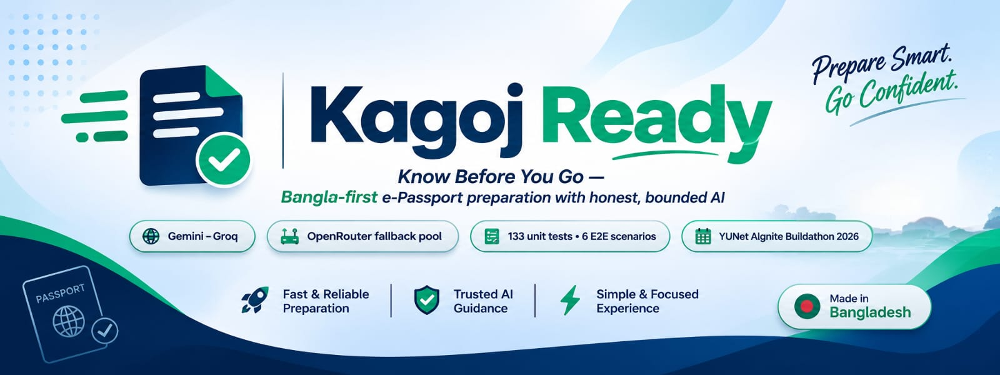
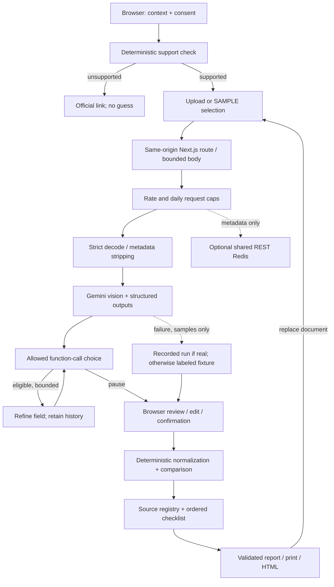
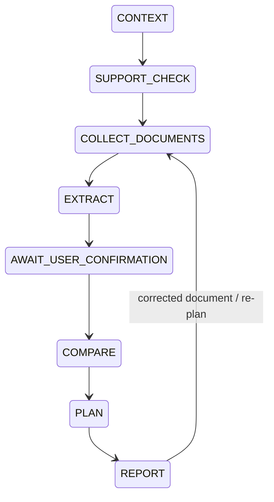
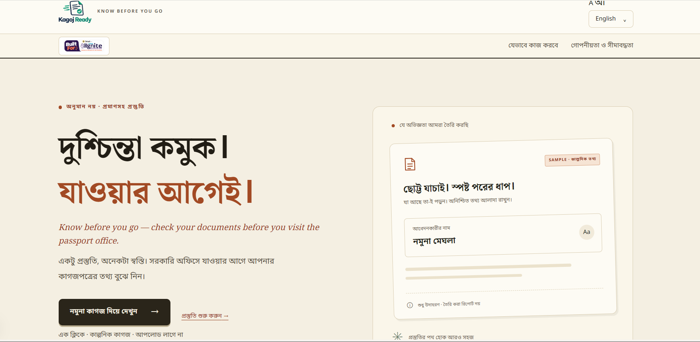
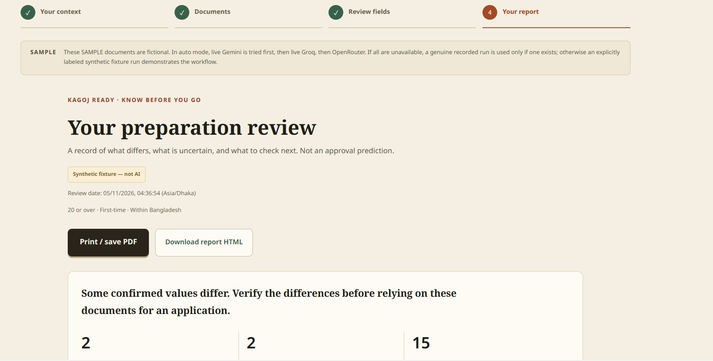

<div align="center">



[](package.json)
[](#-verification)
[](#)
[](#)
[](#)
[](#)
[](#-vercel-deployment)
[](#-buildathon-assets)


**A Bangla-first, mobile-first preparation aid for adult first-time e-Passport applicants aged 20+, applying from Bangladesh.**

Kagoj Ready compares an applicant's documents _before_ the application journey begins — and shows exactly what would go wrong. It is not a chatbot, government portal, legal adviser, identity authority, or approval predictor.

> [!IMPORTANT]
> **Honest status:** live model accuracy is **unmeasured** (the evaluation harness reports only what it actually ran), and the official requirement entries in the registry stay **unverified placeholders** until a human checks them against government sources. The synthetic SAMPLE journey demonstrates the complete product without any personal document.
> - Live document reading uses free-tier vision models; accuracy varies with photo quality, and no accuracy figure is claimed. Every field is confirmed by the user before comparison.

</div>

**Contents:** [Highlights](#-highlights) · [Honest AI](#-honest-ai-by-design) · [Screenshots](#-screenshots) · [Run locally](#-run-locally) · [Verification](#-verification) · [Deploy](#%EF%B8%8F-vercel-deployment) · [Troubleshooting](#-troubleshooting-local-runs) · [Docs](#-project-documentation)

---

## ✨ Highlights

|                                                  |                                                                                                                                                                                                                       |
| ------------------------------------------------ | --------------------------------------------------------------------------------------------------------------------------------------------------------------------------------------------------------------------- |
| 🧭 **A guided journey, not a chatbot**           | Context → documents → mandatory field confirmation → deterministic comparison → checklist/report → corrected-document re-plan. The complete local journey is implemented with a production build and automated tests. |
| 🧠 **Honest AI with a real fallback chain**      | Gemini → Groq → OpenRouter free-model pool (Google → NVIDIA → dots) → clearly labeled synthetic fixture. A case never dies with one provider, and the UI always names what actually ran.                              |
| ✅ **Deterministic comparison, not model vibes** | Unicode normalization, Bangla digit conversion, honorific handling, Jaro-Winkler/Levenshtein and token comparisons — **code, not an LLM**, decides match severity.                                                    |
| 🔒 **Privacy-first architecture**                | No accounts, no case database, no server persistence of images or fields; memory-only images; masked ID numbers; one-click "Delete my data".                                                                          |
| 🇧🇩 **Bangla-first Papery design**                | Newsroom-minimalism: warm ivory paper, near-black ink, Noto Serif Bengali headlines, restrained vermilion accent, muted forest green reserved for verified/success semantics.                                         |
| 🧪 **142 automated tests**                       | 136 unit tests across 11 Vitest files + 6 E2E scenarios (Playwright, including an axe accessibility scan) guarding the full journey.                                                                                  |

## 🧠 Honest AI by design

A vision model identifies the uploaded document and transcribes visible fields into a Zod-constrained schema. Code applies additional date, length and evidence sanity checks. Missing fields stay `null`; raw evidence is never replaced by an invented value.

One bounded workflow governs tool permissions and transitions. When low-confidence non-null fields remain, the model chooses between exactly two allowed calls — `refineExtraction` and `requestUserConfirmation`. Each field can be re-read at most twice; the document loop permits at most four refinement choices. Disallowed names, extra arguments, non-eligible fields and multiple calls are rejected. Refinement history preserves both readings.

Code — **not an LLM** — controls applicability, confirmation, normalization, comparisons, severity, missing-document rules, task dependencies and final report structure. Plain-language explanations are grounded translated templates, deliberately **not unrestricted model-written prose**; the `explainFinding` tool cannot add legal claims. The agent pauses in `AWAIT_USER_CONFIRMATION`: every identity field, low-confidence field, and edited field must be confirmed or acknowledged missing before comparison. A schema-valid OCR result alone never establishes identity.

### Implemented architecture





On replacement, only the affected document is extracted and reviewed. Unaffected pairs retain their findings. The final report and checklist are rebuilt using current registry metadata; changed statuses and values appear in a before/after diff. No automatic legal-record correction occurs.

### Tools and guards

See `src/lib/agent/machine.ts` for state-specific allowlists. `extract.ts`, `report.ts`, and `src/lib/domain/*` implement the tools. Deterministic tools run under code control; the model chooses only among exposed refinement/pause actions. There is no automatic SDK tool execution or arbitrary function dispatch.

- **12 generation attempts per case**, including transient retries and function-call choices.
- **60,000 reserved tokens per case**, enforced before a generation call. Each request also has a configurable per-document budget (default 40,000).
- Maximum output 2,200 tokens per vision call by default; 1,024 for the small tool-choice call.
- Per-provider-operation deadline default 22 seconds; overall request deadline 50 seconds; route max duration 60 seconds.
- At most one retry for HTTP 500/502/503/504 on vision operations. No "retry until the answer agrees", and no retry on malformed output/quota/schema failure. Tool-choice errors fail safely without retries.
- Token accounting is a conservative preflight reservation, **not a currency billing guarantee**. Hosted model reasoning/token semantics still need a live check.
- Three document slots maximum, one image per document. Replacing a slot uses the remaining case budget rather than resetting it.

## 📸 Screenshots

<table>
  <tr>
    <td width="50%"><p align="center"><sub>Bangla-first home — language and large-text controls</sub></p></td>
    <td width="50%"><p align="center"><sub>Deterministic comparison report with source-check tasks</sub></p></td>
  </tr>
</table>

## 🚀 Run locally

Node.js **20.19+** and npm (or [bun](https://bun.sh)):

```bash
cd kagoj-ready
bun install --frozen-lockfile   # lockfile is bun.lock; `npm ci` is not supported (no package-lock.json)
# fallback without bun: npm install
cp .env.example .env.local
# Privately set GEMINI_API_KEY and GEMINI_MODEL when available.
# Optional free backup: GROQ_API_KEY — used automatically if Gemini fails.
# Optional third fallback: OPENROUTER_API_KEY — free vision-model pool, used
# automatically when both Gemini and Groq fail, so a case never dies with one provider.
npm run check:providers          # see exactly which providers work before you start
npm run dev
```

Open `http://localhost:3000`. Use **Try with sample documents** for the complete journey without a key. Default scenario: baseline + mother's-name conflict. Select **Synthetic fixture only — no model** for a deterministic demo. Default auto mode tries the live chain and labels its fallback honestly.

> [!TIP]
> `npm run check:providers` prints your remaining OpenRouter free-model quota for the day and tests the actual model pool with an image — run it after any `.env.local` change (and restart the dev server afterwards).

> [!WARNING]
> Never paste API keys in chat, commit `.env.local`, or prefix server keys with `NEXT_PUBLIC_`. Choose a current supported vision/structured-output model from the official [Gemini model catalog](https://ai.google.dev/gemini-api/docs/models); **no model name is hard-coded**. See [SDK notes](docs/gemini-sdk-notes.md).

### Environment variables

| Variable                                                                        | Default            | Purpose                                                                                                                                                                                                                       |
| ------------------------------------------------------------------------------- | ------------------ | ----------------------------------------------------------------------------------------------------------------------------------------------------------------------------------------------------------------------------- |
| `GEMINI_API_KEY` / `GEMINI_MODEL`                                               | —                  | Primary live vision provider (server-only).                                                                                                                                                                                   |
| `GROQ_API_KEY` / `GROQ_MODEL`                                                   | auto               | Optional backup; an empty model resolves the newest vision-capable model from Groq's `/models` at runtime.                                                                                                                    |
| `OPENROUTER_API_KEY`                                                            | —                  | Third fallback: free vision models when both Gemini and Groq fail. Get a key at [openrouter.ai/keys](https://openrouter.ai/keys).                                                                                             |
| `OPENROUTER_MODEL` / `OPENROUTER_FALLBACK_MODEL` / `OPENROUTER_FALLBACK_MODELS` | built-in free pool | Empty = `google/gemma-4-31b-it:free`, then automatic cross-vendor tries on `nvidia/nemotron-3.5-super-vl:free`, `google/gemma-4-26b-a4b-it:free`, `dots-studio/dots-3-note-preview:free` when one is rate-limited (HTTP 429). |
| `MODEL_TIMEOUT_MS`                                                              | `22000`            | Per-model-call deadline; also bounds the whole fallback attempt chain.                                                                                                                                                        |
| `MODEL_MAX_OUTPUT_TOKENS`                                                       | `4096`             | Maximum tokens per vision call.                                                                                                                                                                                               |
| `DOCUMENT_TOKEN_BUDGET`                                                         | `40000`            | Per-document token budget.                                                                                                                                                                                                    |
| `RATE_LIMIT_PER_MINUTE`                                                         | `20`               | Per-IP/minute request cap.                                                                                                                                                                                                    |
| `DAILY_REQUEST_CAP`                                                             | `1500`             | Global UTC-day request cap.                                                                                                                                                                                                   |
| `RULE_STALE_DAYS`                                                               | `90`               | Requirements older than this are unusable for mandatory tasks (build-time setting).                                                                                                                                           |
| `UPSTASH_REDIS_REST_URL` / `UPSTASH_REDIS_REST_TOKEN`                           | —                  | Optional shared REST Redis: only hashed IP keys, opaque IDs, counters and expiry — never document data.                                                                                                                       |
| `RATE_LIMIT_SALT`                                                               | —                  | Strong salt for hashed IP keys when Redis is enabled.                                                                                                                                                                         |
| `ALLOW_IN_MEMORY_LIMITS`                                                        | `false`            | Vercel live processing fails closed without shared limits; `true` explicitly accepts the weaker per-process behavior.                                                                                                         |
| `ENABLE_LAB`                                                                    | `false`            | Diagnostic `/lab` route — off in production.                                                                                                                                                                                  |

## 🧪 Verification

```bash
npm run typecheck
npm test
npx playwright install --with-deps chromium
npm run test:e2e
npm run format:check
npm run build
npm run start
```

### Automated test inventory

| Suite                |   Tests | What it guards                                                                         |
| -------------------- | ------: | -------------------------------------------------------------------------------------- |
| `schemas.test.ts`    |      21 | Zod schemas and sanity checks (dates, lengths, allowed values)                         |
| `security.test.ts`   |      20 | CSP and headers, upload validation, IP handling, error scrubbing                       |
| `domain.test.ts`     |      18 | Normalization, Bangla digits, name and date comparison, severity                       |
| `pipeline.test.ts`   |      18 | Extraction → confirmation → comparison → checklist pipeline                            |
| `gemini.test.ts`     |      13 | Gemini structured output, function calls, `countTokens` regression                     |
| `http.test.ts`       |       8 | Same-origin guard, bounded bodies, safe responses                                      |
| `json.test.ts`       |       8 | Salvaging fenced or prose-wrapped model JSON                                           |
| `openrouter.test.ts` |       8 | Free-model pool walking on 429 or invalid output                                       |
| `agent.test.ts`      |       7 | Bounded state machine, tool allowlists, step budget                                    |
| `chain.test.ts`      |       7 | Gemini → Groq → OpenRouter fallback, honest labelling                                  |
| `route.test.ts`      |       5 | API routes, budgets, rate limits                                                       |
| **Unit total**       | **133** | `npm test`                                                                             |
| Playwright E2E       |       6 | Full journey, re-plan diff, unsupported case, mobile, fallback, axe accessibility scan |

Browser tests cover the real sample route and confirmation/re-plan/report journey, a separately mocked provider smoke test, unsupported context, mobile layout, honest fallback, download, print and deletion. Transport mocks test Gemini JSON/function-call handling. These tests **do not establish live model performance**.

## 🧭 Routes

| Route               | Purpose                                                        |
| ------------------- | -------------------------------------------------------------- |
| `/`                 | Bangla-first landing, language and large-text controls         |
| `/prepare`          | Actual context, consent, uploads, confirmation and report      |
| `/prepare?sample=1` | Complete synthetic sample journey                              |
| `/evaluation`       | Script-produced live and fixture evaluation results, separated |
| `/privacy`          | Data handling, retention qualifications and limitations        |
| `/matching-rules`   | Public explanations of deterministic software rules            |
| `/lab`              | Single-sample diagnostic extraction lab, not the main journey  |
| `POST /api/cases`   | Creates an opaque, short-lived processing-budget ID            |
| `POST /api/agent`   | Bounded image processing with SSE events                       |
| `POST /api/samples` | Legacy single-sample diagnostic endpoint                       |

## ☁️ Vercel deployment

`vercel.json` configures a single Next.js deployment and bounded route durations. No deployment was performed: no authenticated Vercel access/token was supplied, and the conversation's Vercel connector is unsupported.

1. Import this repository into your Vercel account (or run `npx vercel` and authenticate locally).
2. Set `GEMINI_API_KEY`, `GEMINI_MODEL`, shared-store settings, a strong `RATE_LIMIT_SALT`, and desired request limits in server environment variables.
3. Keep `ALLOW_IN_MEMORY_LIMITS=false`. Set `RULE_STALE_DAYS` before the build.
4. Deploy; Vercel detects `bun.lock` and installs with bun, then runs `npm run build`.
5. Run the synthetic scenario on that domain; verify live labels, source badges, schema behavior, mobile camera file selection, API timeouts, shared caps, print and deletion.
6. Run live evaluation, review evidence and update the registry only after human source verification.

The 4 MiB single-image limit leaves multipart headroom under typical platform request-body limits; validate limits on your actual hosting plan. Preview iframe camera permissions may differ from opening the deployment directly.

### Shared limits and serverless behavior

With `UPSTASH_REDIS_REST_URL` and `UPSTASH_REDIS_REST_TOKEN`, atomic Lua operations enforce shared per-IP/minute limits, a global UTC-day request cap, and per-case generation/token reservations. Redis holds **only hashed IP keys, opaque IDs, counters and expiry metadata**, never documents/fields. Case budgets expire after one hour; rate keys expire automatically.

Without a shared store, local in-memory controls are **per process** and daily/rate limits reset across instances. Unknown case IDs fail closed; they do not silently restart a live budget. IP trust depends on a correctly configured hosting proxy; do not expose a spoofable direct origin in production. On Vercel, live model processing **fails closed without shared limits by default** — `ALLOW_IN_MEMORY_LIMITS=true` explicitly accepts the weaker behavior and is not recommended for public use. The shared-store adapter is implemented but cannot be claimed live-verified without an actual store credential/integration run.

## 🛠 Troubleshooting local runs

<details>
<summary><b>Click to expand</b> — every known failure and its fix</summary>

- **Keys:** put `GEMINI_API_KEY` and `GEMINI_MODEL` in `.env.local` (or `.env`); `npm run dev`, `npm run eval` and `npm run check:providers` all read both. Restart the dev server after any env change.
- **Which model name?** Run `npm run models` to list the models your key can call; choose a current flash model that accepts images.
- **"systemInstruction parameter is only supported in Gemini Enterprise Agent Platform mode":** fixed in `src/lib/ai/gemini.ts` and `src/lib/agent/provider.ts` (the Developer API rejects `systemInstruction`/`tools` in `countTokens`); a regression test guards it.
- **`npm audit` high severity:** came from a dev-only `picomatch` range; `package.json` now has an `overrides` entry.
- **Provider self-check:** `npm run check:providers`.
- **Gemini "The Gemini API free tier is not available for this project" (HTTP 403):** your project/region has no Gemini free tier — only enabling billing unlocks it, and no model name fixes this. The app still works: the chain continues with OpenRouter automatically. Either enable billing at [aistudio.google.com/billing](https://aistudio.google.com/billing), try once with a freshly created key, or blank `GEMINI_API_KEY` + `GEMINI_MODEL` in `.env.local` so the app skips it instantly.
- **Groq "vision-capable: NONE":** expected as of November 2026 — Groq no longer serves a vision model. Keeping the key is harmless (the app resolves a vision model automatically if Groq restores one) or blank `GROQ_API_KEY` to save one failed call per document.
- **OpenRouter "No models provided" (HTTP 400):** an empty `OPENROUTER_MODEL=` line in `.env.local` used to disable the provider and the self-check. Both now treat an empty value as the built-in free default (`google/gemma-4-31b-it:free`).
- **OpenRouter HTTP 429:** free models allow 20 requests/min and 50/day per account (resets 00:00 UTC ≈ 6am Bangladesh; `$10` of credits raises the daily cap to 1000). A 429 with "Provider returned error" usually means the upstream pool is momentarily saturated, not your own cap. The provider now walks a pool of free vision models from **different upstream vendors** (Google → NVIDIA → dots) — up to 4 attempts per call — and `npm run check:providers` prints your remaining daily free quota via the `/api/v1/key` endpoint.
- **"openrouter: INVALID_OUTPUT" on your own document (fixed):** free vision models sometimes answer in prose or emit JSON that fails validation on one document while another model reads it fine. The provider now (1) salvages fenced/prose-wrapped JSON before giving up, (2) walks the 4-model pool on invalid output the same way it walks on 429, and (3) says `model output truncated (finish_reason=length)` explicitly when the response was cut — the remedy then is `MODEL_MAX_OUTPUT_TOKENS=4096` together with `DOCUMENT_TOKEN_BUDGET=20000` in `.env.local`. Groq is also skipped instantly when the account has no vision-capable model (previously it called a retired model id and burned an HTTP 404 per document), and a Gemini 403 is skipped for the remaining operations of the same request.

</details>

## 📚 Project documentation

| Document                                     | Contents                                                                                           |
| -------------------------------------------- | -------------------------------------------------------------------------------------------------- |
| [Matching rules](docs/matching-rules.md)     | Unicode normalization, Bangla digits, date parsing, Jaro-Winkler/Levenshtein and token comparisons |
| [Demo script](docs/demo-script.md)           | Two-minute guided demo for judges                                                                  |
| [Gemini SDK notes](docs/gemini-sdk-notes.md) | SDK integration notes and model selection                                                          |

## 🏛 Buildathon assets

**Visual identity (Papery theme):** the UI uses a newsroom-minimalism design system — warm ivory paper background, near-black ink, serif headlines (Noto Serif Bengali / Noto Serif), a restrained vermilion accent, and muted forest green reserved for verified/success semantics. The owner-supplied **Kagoj Ready logo** (`public/logo.png`) appears in the header, footer and favicon, and the **official "Built for Ostad presents YUNet AIgnite Buildathon 2026" sticker** (`public/buildathon-sticker.png`) is shown in the masthead strip near the top of every page and at the end of every printed report. Both are plain `` references — swap the files in `/public` to replace them.

`src/components/BuildathonWatermark.tsx` renders the sticker in two places: `BuildathonSticker` (compact chip in the masthead strip) and the default `BuildathonWatermark` (full sticker at the end of every page footer and printed report). Assets live at `public/buildathon-sticker.png` and `public/buildathon-chip.png`; replace those files (or the exported constants) to swap assets without code changes.

## 🧮 Matching and sources

[Matching logic](docs/matching-rules.md) documents Unicode normalization, Bangla digit conversion, punctuation/whitespace handling, numeric date parsing, honorific handling, Jaro-Winkler/Levenshtein and token comparisons.

Statuses: `match`, `format_difference`, `possible_variation`, `possible_discrepancy`, `unreadable`, `missing`, `not_applicable`. Cross-script names remain **review-level**, never proof of legal identity. Different document systems' identifiers and issue dates are not expected to agree. `action_required` means verify a difference, never guaranteed rejection.

`src/data/requirements/passport.json` contains two starting-source placeholders. **No legal requirement, fee, timeline, office, eligibility criterion or required-document list has been inferred.** Only the owner may mark a rule `verified`. Null, future or stale verification dates make it unusable for mandatory tasks. Requirements match exact applicant categories; they never inherit across categories.

`RULE_STALE_DAYS` (default 90) is a non-secret build setting shared with the browser. Rebuild after changing it. Fetch dates are never verification dates. The report makes the absence of confirmed requirements explicit; it cannot certify application completeness.

Mandatory tasks and specific missing-document requests can arise **only from verified, current, matching-category rules**. Current placeholders therefore create a "confirm manually" source-check task, not fictional obligations. Root discrepancies/uncertainty precede dependent preparation steps.

## 📊 Synthetic data and honest evaluation

Eight original watermarked SAMPLE cards and their hashes/ground truth are in `public/samples` and `src/data/samples.json`:

- Baseline and a second card with exact shared fields plus format-only differences.
- Bangla/English parent-name variant.
- Mother-name conflict and DOB conflict.
- Missing field, intentionally blurry image, wrong-document receipt.

All names and numbers are fictional. These are diagnostic cards, **not authentic government templates**. The same scenario appears in tests, the demo and the [two-minute script](docs/demo-script.md).

```bash
npm run eval       # Live only. Reads .env.local. May incur Gemini charges.
npm run eval:mock  # Separate fixture round-trip + deterministic comparison test.
```

Both scripts use `extractWithAgent`, the same extraction workflow as the app. Live uses `AgentGeminiProvider`; mock uses the labeled ground-truth adapter. Hashes are checked before running. Output:

- `evaluation/latest.json`: live results, or `status: "blocked"`, zero attempts and null accuracy when not configured.
- `evaluation/mock-test.json`: computed fixture metrics, explicitly **not model extraction accuracy**.
- `src/data/recorded-samples.json`: written **only by a real live synthetic evaluation that produces results**. Currently empty. Mock runs cannot create a "recorded Gemini run." Rebuild to publish newly recorded results.

Field accuracy uses strict NFC equality, counting whitespace differences as errors. Bangla/English text groups exclude dates/IDs. Failed readable runs stay in field denominators. Missing/null fields are measured separately. Wrong/blurry images test identification/rejection.

Conflict precision and recall use `possible_discrepancy` as the positive class; variants must remain review-level. Missing expected-conflict pairs count as false negatives. Evaluation-only code acknowledges raw outputs to exercise deterministic comparison; this is **not simulated human verification or a production confirmation bypass**.

Exit codes: 0 completed, 2 blocked/partial failure, 1 setup/integrity failure. A completed run is not automatically an accuracy-gate pass. No gate threshold was invented. `/evaluation` reads the generated JSON; rebuild after rerunning the scripts.

> [!NOTE]
> **Current live performance: unmeasured.** There have been no live model runs. Fixture results cannot be used as an AI accuracy claim.

## 🔒 Privacy, security and data lifecycle

- No auth/accounts, database of cases, vector store, external analytics or server persistence of images/OCR/fields.
- Browser session storage holds context, extracted fields, edits, confirmations and reports. Image files are memory-only and not placed in session storage. This is **not encrypted browser storage**; do not use shared devices for sensitive data.
- "Delete my data" clears all `kagoj:` session keys and current case state, aborts browser requests, and prevents late responses from restoring deleted data. It cannot delete downloaded reports or provider-retained data. Browser session restoration can restore storage; explicitly delete when done.
- Uploads travel through server memory to model inline image parts. No Files API or persisted interaction IDs. Provider terms (e.g. [Google's](https://ai.google.dev/gemini-api/terms)) govern provider-side retention. Hosting providers may retain request metadata.
- Personal uploads use live providers or a clear error, **never a fixture fallback**. Sample auto mode uses live → genuine recording if available → explicitly labeled synthetic fixture.
- Identity-number text is masked to its last four characters in review/report/export. Full raw values remain in the browser case for user-controlled comparison; this is disclosed.
- Strict MIME/extension/decoded-format checking; full image decoding, metadata stripping, one-page PNG/JPEG only, max 4 MiB, minimum 320 × 240, maximum 6000 per side and 16 million total pixels. PDFs/multipage images are rejected.
- Request bodies are bounded before parsing; context/consent/sample IDs/document slots are runtime-validated. Same-origin requests only; no permissive CORS. Processing responses and client fetches are `no-store`.
- No application logging of document content, extracted fields or provider error bodies. User errors are allowlisted codes and translated recovery text. React escapes UI text; downloaded report HTML is explicitly escaped.
- Security headers are provided. CSP allows Next.js inline bootstrap and development eval; a stricter nonce CSP is a possible hardening step, not claimed here.

## 🚧 Remaining owner inputs / release gates

1. Privately configured Gemini API key and supported model; live extraction/function-calling evaluation.
2. Human verification of actual requirements; no source rules are verified by this build.
3. Authenticated Vercel deployment access and shared-store configuration/integration check.
4. Presenter name/background and confirmation of the assumed Bangladesh timezone for the owner-provided deadline.
5. Manual camera/device and accessibility review. Automated smoke checks are not a full accessibility certification.

NID correction, submission, legal record updates, legal determinations, requirements chatbot and PDF-generation library are intentionally not implemented. The browser's print dialog can save the complete report as PDF. No application approval or readiness score is shown.

---

<div align="center">

**Kagoj Ready** · v0.3.0 · Built for _Ostad presents YUNet AIgnite Buildathon 2026_ · Made with care in 🇧🇩

</div>
